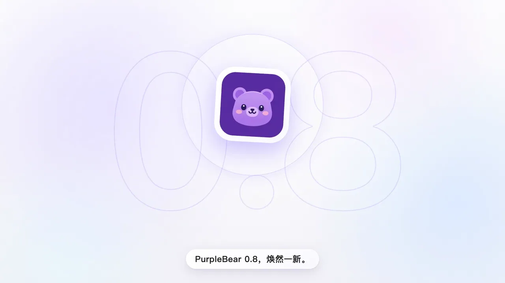

<p align="center">
  <a href="https://github.com/mallocfeng/PurpleBear/releases/download/v0.8.1/PurpleBear-0.8-promo.mp4">
    
  </a>
</p>

<p align="center">
  <a href="https://github.com/mallocfeng/PurpleBear/releases/download/v0.8.1/PurpleBear-0.8-promo.mp4"><b>▶ 观看完整宣传片（63 秒，含配音）</b></a>
</p>

<h1 align="center">PurpleBear</h1>

<p align="center">
  好看又好用的 Android 代理客户端，基于 Xray 内核。
</p>

<p align="center">
  <a href="https://github.com/mallocfeng/PurpleBear/releases/latest"></a>
  
  
  <a href="LICENSE"></a>
</p>

<p align="center">
  <a href="https://github.com/mallocfeng/PurpleBear/releases/latest"><b>下载最新版</b></a> ·
  <a href="CHANGELOG.md">更新日志</a> ·
  <a href="privacy-policy.html">隐私政策</a>
</p>

PurpleBear 通过 Android 系统 VPN 接入 Xray 内核，把订阅管理、节点测速、分流规则、分应用代理、流媒体出口和 Tailscale 组网放进一个干净、顺手的界面里。应用不内置任何服务器或机场，所有节点都由你自己导入。

## 亮点

- **全新界面**：分组列表式设计，信息清楚，操作少，支持浅色、深色两种主题。
- **液态玻璃导航**：底部导航栏是真正的液态玻璃，内容在下面滚过时会被模糊折射；选中指示可以用手指拖动，按住时透镜放大图标，松手自动吸附。
- **一键连接**：首页一个按钮，连接状态、时长和速度一目了然。
- **一秒导入**：订阅链接、分享链接、二维码、文件都能导入，主流协议都支持。
- **分流随心**：规则分流和全局代理一键切换，国内直连、海外走代理；还可以按应用、按流媒体服务单独指定线路。
- **更安全**：本地代理端口每次随机分配并强制认证，自签证书节点会自动固定证书指纹。

## 功能

### 连接

- 基于 Android `VpnService` 建立系统级 VPN，一键连接、断开、切换线路。
- 首页显示连接状态、当前节点、运行时长和上下行速率；当前节点卡片可以直接测速、看详情、切换。
- 支持系统通知栏状态和下拉菜单快捷开关（Quick Settings 磁贴）。
- 支持打开应用时自动连接、断线自动重连。

### 节点与订阅

- 导入 `http` / `https` 订阅、单节点分享链接（可一次粘贴多条）、二维码（相机或相册）和本地文件。
- 订阅格式：Base64 / 明文链接列表、Clash / Clash Meta（含 `proxy-providers` 的过滤与覆盖、`dialer-proxy` 链式代理）、sing-box、SIP008、Xray / v2rayN JSON、Surge、Loon、Quantumult X。
- 获取订阅时同时以普通方式和 Clash Meta 方式请求，自动采用节点更完整的一份；面板返回网页或错误时也能拿到节点。
- 订阅分组和 Local 本地分组，可折叠；支持收藏置顶、搜索和按地区、低延迟筛选。
- 一键测速整组节点，延迟按快慢显示绿、黄、红。
- 订阅手动刷新，或在非计费网络下每日自动更新；同来源节点自动去重和覆盖。
- 节点详情展示协议、安全层、传输层、地址和全部参数（默认折叠）。
- 在应用内手动新建节点，支持 TLS / REALITY、WebSocket、gRPC、mKCP、HTTP Upgrade 等参数，也可以用分享链接预填。

### 支持的协议

| 协议 | 说明 |
| --- | --- |
| VLESS | TLS、REALITY、Vision；TCP / WebSocket / gRPC / XHTTP / HTTPUpgrade / mKCP |
| VMess | TCP、WebSocket、gRPC、mKCP 等 |
| Trojan | TLS 及各类传输 |
| Shadowsocks | 2022 与 AEAD 加密；obfs / shadow-tls / restls 插件 |
| Hysteria2 | 基于 QUIC，支持 salamander 混淆和端口跳跃 |
| SOCKS / HTTP | 现成的 SOCKS5 或 HTTP 代理 |
| WireGuard | 链接、Clash、sing-box、Surge 均可导入 |
| TUIC / AnyTLS / Hysteria v1 / Snell / Mieru / SSH | 通过内置 mihomo 兼容内核运行 |
| SSR / ShadowsocksR | 通过内置 mihomo 兼容内核运行 |

Xray 能运行的节点交给 Xray；Xray 不支持的协议和配置（包括新版 Xray 已移除的 HTTP/2 传输、旧版 XTLS 流控、旧式 SS 加密等）自动交给内置的 mihomo 运行。两个内核都不支持的节点（如 naive、旧 V2Ray 的 QUIC 传输）会在导入时说明原因。实际可用性取决于节点参数、服务端配置和网络环境。

### 线路组合

- **前置代理**：让节点先经另一个节点中转再出站，支持多跳链式出口；任何可用节点（包括兼容内核运行的 TUIC、AnyTLS、Snell 等）都可作为前置。出口跳过证书校验时，证书经前置链路获取，不会直连出口服务器。兼容内核运行的节点作出口时暂不支持前置代理。
- **备用节点**：主节点检测失败时自动切换到备用节点，主节点恢复稳定后自动切回；检测在 VPN 服务里运行，不依赖界面在前台。

### 分流规则

- **代理模式**：在“规则分流”和“全局代理”之间一键切换。全局代理下，除局域网外所有流量都走代理，规则暂不生效。
- **直连地区**：可选中国、美国或俄罗斯，对应的网站和 IP 直连（基于 geosite / geoip）。
- **规则源**：内置 Shadowrocket / Surge 默认规则，支持添加文本规则或规则 URL，可单独启用、禁用和刷新。
- **Geo 数据**：内置 `geoip.dat` 与 `geosite.dat`，可在应用内更新。

### 分应用代理

- 只让选中的应用进入 VPN，其他应用保持直连。
- 支持按应用名称或分类搜索；修改名单后自动重连生效。

### 流媒体分流

- 为 Netflix、Disney+、YouTube、Prime Video、Hulu、Max、Spotify、Apple TV、Bahamut、AbemaTV、BiliBili、DAZN 等服务单独指定出口节点。
- 未指定的服务走默认线路；流媒体规则会转换成 Xray 路由规则生效。

### Tailscale

- 内置 Tailscale 节点，使用认证密钥加入你的 Tailnet，可与代理 VPN 同时运行。
- 支持自定义控制服务器（如 Headscale）、始终使用 DERP、选择出口节点。
- 支持子网路由：自动识别 Tailnet 已公布的私有网段，也可手动添加，仅在你选择后才接管对应流量。
- 支持 MagicDNS：VPN 内可直接用设备名（如 `nas` 或 `nas.xxx.ts.net`）访问 Tailnet 设备，其他域名的 DNS 和走向保持不变。
- Tailscale 进程意外退出时自动恢复连接。

### 安全

- **本地代理认证**：Xray 的 SOCKS / HTTP 入站和兼容内核（mihomo）的端口每次连接都随机分配，并带随机账号密码，其他应用无法借用本地代理绕过分应用设置或探测出口 IP。
- **证书固定**：新版 Xray 已移除 `allowInsecure`。节点链接中标记跳过证书校验时（`allowInsecure` / `insecure` / `skip-cert-verify`），应用会在连接前获取服务器证书并固定其 SHA-256 指纹；也可以在节点中手动填写证书指纹（`pcs`）或按名称校验（`vcn`）。

### 诊断与设置

- **系统诊断**：一键检查配置解析、规则资源、Xray 内核、VPN、DNS、节点连通性和代理出口，并可复制诊断摘要。
- **日志**：应用内查看运行日志、Xray 错误日志和访问日志；日志级别可选 error、warning、info、debug。
- **DNS**：系统 DNS、远程 DNS、自定义 DNS 三种模式。
- **其他**：中文、英文、俄文界面；浅色、深色主题；VPN MTU 设置；备用节点心跳间隔设置。
- **应用内更新**：每天自动检查 GitHub Release，可在应用内直接下载 APK 并交给系统安装。

## 下载与安装

1. 在 [GitHub Releases](https://github.com/mallocfeng/PurpleBear/releases/latest) 下载 `app-release.apk`。
2. 需要 Android 8.0 及以上的 64 位 ARM 设备（`arm64-v8a`）。
3. 首次连接时按系统提示授予 VPN 权限。

之后有新版本时，应用会自动提示升级，也可以在“我的 → 设置 → 检查更新”中手动检查。

## 隐私与数据

- PurpleBear 不内置任何订阅、机场或代理服务器。
- 导入的订阅、节点、规则和设置只保存在本机。
- 只有在你同步订阅、规则、Geo 数据或检查更新时，应用才会访问对应地址。
- VPN 功能需要系统 VPN 授权；分应用代理需要读取本机应用列表。
- 详见 [隐私政策](privacy-policy.html)。

## 从源码构建

### 环境

- JDK 17
- Android SDK：compileSdk 37.1，targetSdk 35，minSdk 26
- 仓库内置 Gradle Wrapper（Gradle 9.9.1，AGP 9.5.1，Kotlin 2.4.21）
- 发布包只面向 `arm64-v8a`

### 构建

```bash
./gradlew :app:assembleDebug
```

```bash
./gradlew :app:testDebugUnitTest :app:assembleRelease
```

Release 包输出在 `app/build/outputs/apk/release/app-release.apk`。签名读取仓库根目录的 `keystore.properties`（不纳入版本控制），没有配置时请使用 Debug 构建。

### 内置的原生组件

| 组件 | 位置 | 说明 |
| --- | --- | --- |
| Xray-core / libXray | `app/libs/libXray.aar` | 代理核心，用 gomobile 构建 |
| mihomo | `app/src/main/jniLibs/arm64-v8a/libmihomo.so` | 兼容内核 sidecar（SSR、TUIC、AnyTLS 等），GPL-3.0；缺失时 Xray 协议不受影响 |
| Tailscale bridge | `app/src/main/jniLibs/arm64-v8a/libtailscalebridge*.so` | 由 `tailscale-bridge/build-android.sh` 构建 |

各组件的版本、源码地址和校验值记录在 [THIRD_PARTY_NOTICES.md](THIRD_PARTY_NOTICES.md)。

## 项目结构

| 路径 | 内容 |
| --- | --- |
| `app/` | Android 应用：Kotlin 源码、Compose 界面、资源、预编译内核与 Geo 数据 |
| `tailscale-bridge/` | Tailscale 用户态节点的 Go 桥接源码与构建脚本 |
| `assets/` | README 与宣传用图片 |
| `LICENSES/` | 第三方许可证全文 |
| `index.html`、`privacy-policy.html` | GitHub Pages 项目页与隐私政策 |

## 更新日志

### 0.8.4

- 兼容内核运行的节点（TUIC、AnyTLS、Snell 等）可作为前置代理，也可设置备用节点或被选为备用节点；作出口时前置代理改为灰显提示。
- 修复兼容内核刚启动时端口尚未就绪导致经它获取证书失败；补齐 Flow 等处的翻译。

### 0.8.3

- Tailscale 支持 MagicDNS，进程意外退出后自动恢复；修复控制服务器地址无法清空重填。
- 修复本地导入的节点可能重复 ID，导致打开、删除、前置代理指向错误节点。
- 修复跳过证书校验的出口节点挂在前置代理后无法连接。
- 补齐 Tailscale 页面、导入预览和节点编辑等处的英文与俄文翻译。

### 0.8.2

- 订阅兼容性大幅提升，新增 Surge / Loon / Quantumult X / Xray JSON 导入，新增 TUIC、AnyTLS、Snell 等协议（mihomo 兼容内核运行）。

### 0.8.1

- 修复在子页面点击当前高亮的导航标签时无法返回主页面的问题。
- 修复订阅中 v2rayN 格式的 VMess 节点名称丢失的问题。

### 0.8.0

- 全新界面设计，底部导航改为液态玻璃效果；新增“代理模式”切换、三页启动引导和更清晰的首页。
- Xray-core / libXray 升级到 v26.11.9，mihomo 升级到 v1.19.34，Tailscale 升级到 v1.104.7。
- 本地代理端口随机分配并强制认证；跳过证书校验的节点改为自动固定证书指纹。
- 修复重新连接后无法上网的问题；应用更新改为在应用内下载 APK。
- Tailscale 结束 beta。

完整记录见 [CHANGELOG.md](CHANGELOG.md)。

## 参与贡献

欢迎提交 Issue 和 Pull Request，参见 [CONTRIBUTING.md](CONTRIBUTING.md)。安全问题请按 [SECURITY.md](SECURITY.md) 私下报告。

## 致谢

- [Xray-core](https://github.com/XTLS/Xray-core) 与 [libXray](https://github.com/XTLS/libXray)：代理核心
- [mihomo](https://github.com/MetaCubeX/mihomo)：兼容内核，运行 Xray 不支持的协议（GPL-3.0）
- [Tailscale](https://github.com/tailscale/tailscale)：Tailnet 组网（BSD-3-Clause）
- [AndroidLiquidGlass](https://github.com/Kyant0/AndroidLiquidGlass)：液态玻璃效果（Apache-2.0）
- [v2fly geoip](https://github.com/v2fly/geoip) 与 [domain-list-community](https://github.com/v2fly/domain-list-community)：Geo 数据
- [blackmatrix7/ios_rule_script](https://github.com/blackmatrix7/ios_rule_script)：默认分流规则

## 许可证

PurpleBear 以 [MIT 许可证](LICENSE) 开源。第三方组件保留各自的许可证，详见 [THIRD_PARTY_NOTICES.md](THIRD_PARTY_NOTICES.md)。
